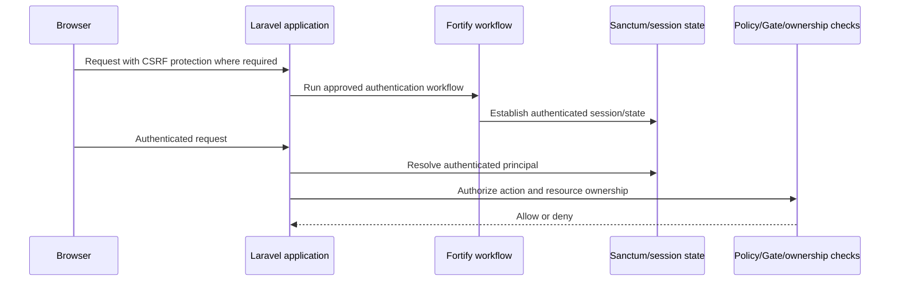

# Authentication

## Status

The authentication stack is **Approved for future implementation design**:

- **Laravel Fortify** is the backend authentication workflow layer.
- **Laravel Sanctum** is the authentication mechanism for appropriate browser and API requests.

No package has been installed, no configuration has been created, and no authentication runtime exists while documentation-only mode is active. Product-specific account flows, verification policies, and mandatory MFA remain open unless stated below.

## Responsibility split

### Laravel Fortify

Fortify is the headless backend workflow capability for authentication concerns such as:

- Login and logout integration.
- Registration when registration is enabled by the approved product scope.
- Password reset.
- Password confirmation.
- Email verification.
- Authentication pipeline customization.
- Authentication throttling integration.
- Two-factor authentication capability when enabled and configured.

Fortify does not choose the product UI, client application, user roles, permissions, resource ownership rules, or business authorization policy. Not every Fortify feature is automatically enabled; each flow requires an approved product and security decision.

### Laravel Sanctum

Sanctum supplies the authentication mechanism for appropriate authenticated requests, including:

- First-party stateful browser or SPA session/cookie authentication where applicable.
- API authentication where an API boundary is approved.
- Personal access tokens only for justified non-browser consumers or integrations.

Sanctum does not provide registration, password reset, email verification, or business authorization. It does not replace Policies, Gates, roles, permissions, ownership checks, or IDOR protection.

Fortify and Sanctum are complementary: Fortify defines or hosts authentication workflows, while Sanctum supports the authenticated state or token mechanism used by protected requests.

## Approved authentication surfaces and identity

The conceptual authentication URL surfaces are:

- Admin: `/admin/login`; public Admin registration is not allowed.
- Seller: `/seller/login` and `/seller/register`.
- Customer: `/login` and `/register`.

These URLs do not define controllers, middleware, guards, session configuration, login identifiers, or verification rules. See [application-surfaces.md](application-surfaces.md) for the portal boundary.

Admin accounts may be created manually for initial bootstrap or by an authorized Admin inside the Admin Panel. Seller registration may create a Seller-classified User directly and enter onboarding. Customer authentication details remain open.

The application uses one conceptual User identity for Admin, Seller, and Customer classifications. A conceptual `account_type` value of `admin`, `seller`, or `customer` describes primary classification only; it is not a role, permission, membership, ownership decision, Policy result, or Gate result.

Account classification does not decide Store access, Seller verification state, or administrative capability. Those decisions remain in the authorization model and current lifecycle state.

## Authentication and authorization boundary

Authentication answers **who is making the request**. Authorization answers **whether that principal may perform this action on this resource in its current state**.

The future implementation MUST continue to enforce backend authorization after authentication. The following remain separate concerns:

- Roles and permissions.
- Laravel Policies and Gates.
- Resource ownership and entitlement.
- Domain or workflow-specific authorization.
- IDOR prevention and authorized-resource lookup.

See [authorization.md](authorization.md) for the canonical authorization rules.

## Intended request flow

Where a first-party stateful browser flow is appropriate, the intended sequence is:

This is a planning flow, not an implementation contract. Exact stateful domains, cookie attributes, CORS rules, trusted origins, and deployment topology remain open and MUST be documented before implementation.

## Session, CSRF, and token expectations

- Stateful browser requests MUST use appropriate secure session and cookie settings.
- CSRF protection MUST remain enabled for applicable cookie-authenticated state-changing requests.
- Cross-origin, trusted-origin, cookie-domain, SameSite, and CORS decisions MUST be made from the actual client and deployment boundaries; no values are selected yet.
- Personal access tokens MUST be issued only for justified consumers, stored and transmitted securely, scoped to the minimum capability, and revocable.
- Tokens, passwords, recovery secrets, and other authentication secrets MUST NOT be logged, exposed in URLs, or included in ordinary cache entries.
- Token expiration/TTL, rotation, revocation, and consumer lifecycle require an explicit policy before token-based integrations are implemented; no token TTL is selected yet.

## Approved capabilities and open policy decisions

- **Registration:** capability available through Fortify when the product enables it; the exact registration policy is open.
- **Admin registration:** public Admin registration is not allowed; internal/bootstrap creation policy is open.
- **Seller registration:** direct Seller registration is an approved surface; fields, identifiers, verification steps, and recovery policy are open.
- **Customer registration:** `/register` is an approved surface; identifiers, verification, and login behavior are open.
- **Email verification:** capability available through Fortify; which actions require verification is open.
- **Password reset and confirmation:** capabilities available through Fortify; recovery, reauthentication, and sensitive-action policy details are open.
- **2FA capability is available through Fortify; mandatory MFA policy remains open.**
- **Suspension and revocation:** account suspension, session revocation, token revocation, and operator access require product/security decisions.
- **Rate limits:** authentication and recovery endpoints MUST use risk-specific throttling; exact thresholds and response behavior are open.

## Future SMS OTP and MFA extensibility

SMS OTP is a planned future authentication/security capability, not part of the current implementation phase. The authentication architecture SHOULD remain extensible enough to add it later, but no provider, OTP lifetime, resend interval, maximum attempts, MFA enforcement policy, fallback provider, or phone-verification flow is selected.

Future OTP security design MUST consider expiration, attempt limits, resend throttling, brute-force protection, OTP bombing prevention, invalidation of previous codes, secure logging, and provider failure behavior.

Authentication architecture should support future MFA/OTP capabilities; mandatory enforcement rules remain undecided.

## Deferred authentication details

Customer authentication details remain open, including whether login is email-only, phone-only, combined, OTP-based, passwordless, or subject to mandatory email/phone verification.

Seller authentication details beyond the approved login/registration surfaces and verification boundary remain open, including login identifiers, email/phone verification, OTP behavior, recovery behavior, password requirements, and exact authentication steps.

Admin authentication details beyond `/admin/login` and no-public-registration remain open, including login identifier policy, MFA enforcement, IP restrictions, session lifetime, reauthentication, and exact bootstrap procedure.

## Security and audit expectations

Authentication workflows MUST be reviewed for brute-force resistance, enumeration behavior, recovery abuse, session fixation, session invalidation, replay, secret exposure, and auditability. Security-relevant events MAY include login success/failure, logout, password reset, email verification, MFA changes/challenges, token issuance/revocation, and account suspension, but final event names and retention are not approved.

Audit and diagnostic logs MUST exclude passwords, tokens, recovery secrets, private keys, and unnecessary personal data. Authentication events do not replace ordinary authorization decisions or business audit records.

## Testing expectations

Future verification SHOULD cover successful and failed authentication, throttling, CSRF/session boundaries, password recovery, verification requirements, token scope and revocation where enabled, MFA behavior where enabled, authorization after authentication, IDOR attempts, and sensitive-data redaction. Exact test tooling and approved product flows remain open.

## Implementation gate

This document describes a future design boundary only. It does not authorize installing Fortify or Sanctum, publishing routes, adding configuration, creating migrations, or implementing authentication logic. Those actions remain blocked until the user explicitly authorizes implementation.
