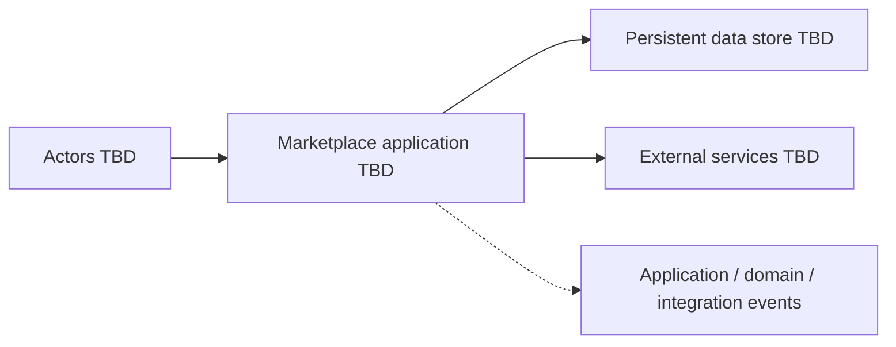

# Architecture Overview

## Status

The production architecture is partially defined. Laravel + MVC + Layered Architecture + SOLID are the approved foundation. Event-Driven Architecture, selective Event Sourcing, backend authorization, Fortify/Sanctum authentication capabilities, four same-application surfaces, and the Marketplace commerce core are also approved. Product scope, Laravel version, deployment, storage, detailed commercial policy, and the scope of Event Sourcing remain open.

## Current system boundary

The only implemented boundary is the documentation repository. There is no application runtime, API, database, deployment, or external integration in scope for the current phase.

## Future logical boundary

The future system boundary should be refined from approved requirements. At minimum, the architecture documentation must distinguish:

- User-facing clients and the application capabilities they invoke.
- Admin Panel, Seller Panel, Customer Panel, and API surfaces within the same Laravel application.
- Core domain behavior owned by the Marketplace system.
- Persistent storage and data ownership.
- External providers or services, if any.
- Administrative and operational access.
- Trust boundaries and security-sensitive flows.
- Master Product catalog, Store Offers, Store Locations, commercial CTAs, click classification, and financial/quota boundaries.

The approved conceptual responsibility/request flow is:

`Presentation / HTTP -> Application / Services -> Business Logic -> Infrastructure / Data Access`

MVC belongs primarily to the Presentation / HTTP boundary. It is not the entire application architecture. This flow is a pragmatic responsibility guide, not a DDD, Clean Architecture, Hexagonal Architecture, or Onion Architecture dependency rule. Layer responsibilities and pragmatic boundary choices are defined in [layered-architecture.md](layered-architecture.md).

The following is a planning placeholder, not an approved architecture:

## Architecture principles

These are planning constraints, not technology selections:

- Keep business rules explicit, testable, and independent from HTTP concerns where practical.
- Use business/domain vocabulary when it improves clarity without introducing DDD ceremony or mandatory aggregates, bounded contexts, repositories, or value objects.
- Allow Eloquent and focused interfaces/repositories where they solve a real persistence or boundary problem; do not create them by pattern reflex.
- Make ownership, authorization, and state transitions visible in the design.
- Treat external systems as unreliable boundaries with explicit contracts.
- Prefer reversible decisions while requirements are incomplete.
- Minimize collection and exposure of sensitive data.
- Use Event Sourcing selectively when historical state, auditability, replayability, or high-value state correctness justify the complexity.
- Treat caching as a non-authoritative optimization layer with domain-specific consistency policies.
- Record durable choices in [decisions.md](decisions.md).

See [caching-strategy.md](caching-strategy.md), [event-driven-and-event-sourcing.md](event-driven-and-event-sourcing.md), [authorization.md](authorization.md), and [concurrency-and-idempotency.md](concurrency-and-idempotency.md) for canonical guidance.

Authentication responsibilities and open policies are defined in [authentication.md](authentication.md).
Portal technology, route, and presentation boundaries are defined in [application-surfaces.md](application-surfaces.md).
Marketplace commerce relationships and cross-cutting constraints are defined in [marketplace-commerce-model.md](marketplace-commerce-model.md).

## Not yet decided

- Application deployment topology.
- Remaining frontend versions, visual design, accessibility targets, and detailed portal behavior.
- Laravel version and supported runtime details.
- Storage technology and consistency model.
- API style and integration protocols.
- Hosting, environments, scaling, and availability targets.
- Background processing, search, and eventing needs.
- Cache backend, topology, and domain-specific cache policies.
